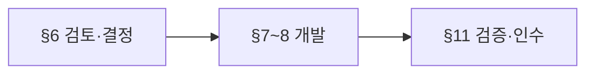
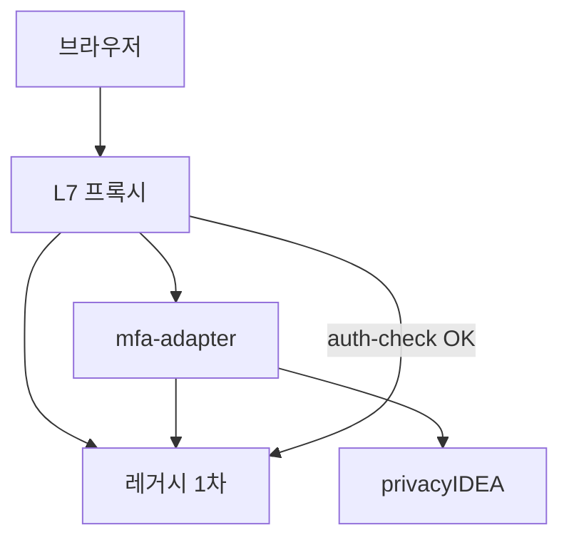
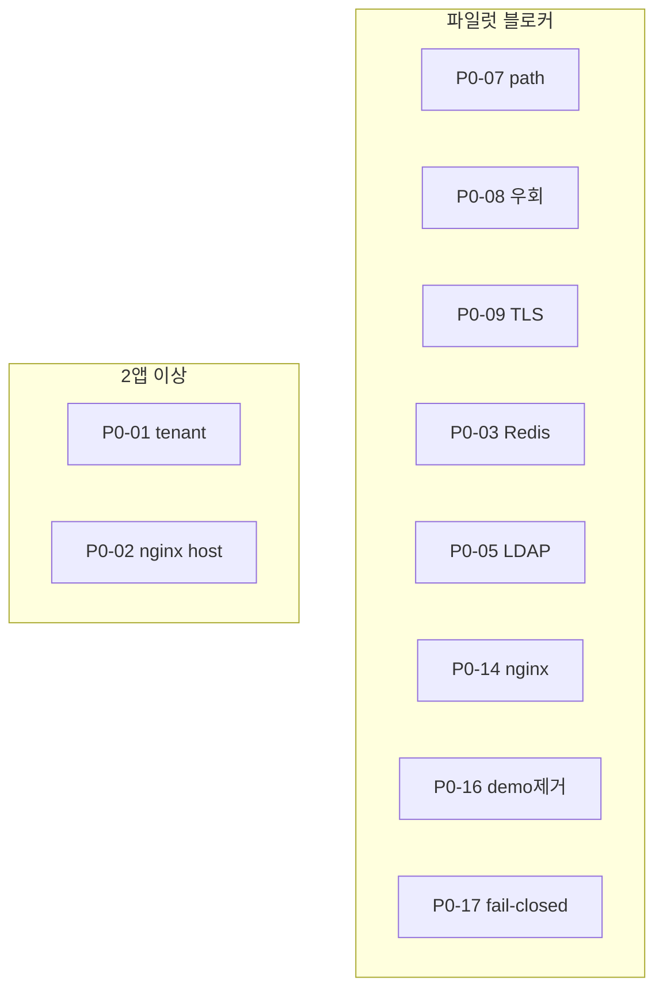

# 레거시 무수정 OTP(MFA) 연동 — 설계 보고서

| 항목 | 내용 |
|------|------|
| PoC 경로 | `poc/google-otp-2fa` |
| 성숙도 | **TRL 4~5** — 단일 랩 앱·브라우저 TOTP 샘플만 입증 |
| 상태 | 데모·설계 완료 / **파일럿·운영은 §6~§8 완료 후** |

**본 문서 초점:** PoC 이후 **검토·결정·추가 개발** 항목. 아키텍처 요약은 §2~§5, 상세는 **§6 이하**.

---

## 1. 요약

| 질문 | 답 |
|------|-----|
| 소스 무수정 OTP | **조건부** — probe·세션 binding·레거시 직접 접근 차단·민감 URL 전수 게이트 |
| PoC로 충분한가 | **아니오** — hybrid 배포, 2 path 게이트, RAM MFA, passwd/HTTP, harness 테스트 |
| 다음 단계 | §6 현장 검토 → §7 P0 개발 → §11 인수 |



---

## 2. 시스템 구성 (참고)



| 구성요소 | 역할 |
|----------|------|
| 프록시 | 유일 공개 진입, `auth_request` |
| mfa-adapter | MFA UI, probe, 2차 상태 |
| privacyIDEA | TOTP 저장·검증 |
| 레거시 | 1차 인증 (소스 변경 없음) |

---

## 3. 인증·probe (참고)

**Binding:** probe JSON의 `session_id`(또는 `LEGACY_BINDING_CLAIM`)를 HMAC — **쿠키 원문만 binding 금지** (새로고침 시 2차 풀림 결함 수정됨).

| probe | Pass | Fail |
|-------|------|------|
| 미로그인 | 401/403 | 200+빈 body |
| 로그인 | 200+`user`+binding ID | HTML만, user 없음 |

```
레거시 login ID == probe user == PI user (+ realm)
```

---

## 4. PoC vs 목표 (한눈에)

| 항목 | PoC | 파일럿/운영 |
|------|-----|-------------|
| 프록시 | `proxy_harness` + nginx conf 문법만 | **운영 nginx** E2E |
| 게이트 path | `/dashboard`, `/api/protected` | **민감 URL 전수** |
| 배포 | Hybrid (PI Docker + host 5000/5001/18080) | nginx만 공개 |
| MFA 상태 | RAM | Redis 등 |
| 계정 | passwd + legacy env | **LDAP/AD** |
| 테스트 | embedded 23 + PI 일부 | `verify_privacyidea.sh` + §11 |

---

## 5. 범위

| In | Out (별도 과제) |
|----|-----------------|
| 프록시·adapter·PI, TOTP | 레거시 소스 수정, 전사 SSO |
| 브라우저·세션 쿠키 | 네이티브 앱, Bearer-only API |

---

## 6. 검토 필요 사항 (현장·설계)

워크숍/Phase 0에서 **답·서명**이 없으면 개발 착수를 멈추는 항목은 **차단**으로 표시.

### 6.1 네트워크·우회

| ID   | 검토 내용                                       | 확인 방법                     | 미충족 시           |
| ---- | ------------------------------------------- | ------------------------- | --------------- |
| N-01 | 레거시·DB·관리 포트가 **클라이언트/VPN에서 직접** 열리는가       | > 방화벽 규칙, `nmap`, 인수 A-01 | **차단** — MFA 우회 |
| N-02 | 앱 **모든** FQDN·IP·포트 목록 (CDN·구버전 URL 포함)     | 앱 오너 인벤토리                 | path 누락         |
| N-03 | 정적/CDN이 **세션 없이** API 호출하는지                 | 아키텍트 인터뷰                  | 게이트 설계 변경       |
| N-04 | **단일 L7 진입점**만 업무 트래픽 사용하는가                 | 네트워크 diagram              | **차단**          |
| N-05 | hybrid 시 **5000/5001**이 `0.0.0.0`인지 (시연 서버) | `ss -tlnp`                | 우회 가능 → 시연 중단   |

### 6.2 레거시·probe (소스 무수정 전제)

| ID | 검토 내용 | PoC | 실제 레거시 |
|----|-----------|-----|-------------|
| L-01 | probe URL·**메서드**(GET만?) | GET `/api/protected` | **확인 필수** |
| L-02 | 응답 **Content-Type** JSON | Flask JSON | HTML 로그인 페이지면 **Fail** |
| L-03 | binding claim 필드명·**세션 내 불변** | `session_id` | 필드 없으면 **설계 변경** |
| L-04 | 로그인 후 **리다이렉트** (`/dashboard` vs `/mfa`) | `/mfa/verify` 기본 | 프록시 403으로 보완 가능, UX 합의 |
| L-05 | **logout** URL·메서드 | adapter가 `GET /logout` 호출 | 고객 logout 불일치 시 1차 세션 잔존 |
| L-06 | 1차 세션 TTL vs MFA TTL | 미정의 | §6.4 정책 합의 |
| L-07 | `next` 등 **오픈 리다이렉트** 유사 패턴 | PoC login에 `next` | 보안 검토 |

**probe 수용 테스트:** 고객 probe에 §3 표를 적용한 **자동/수동 리포트** (→ P0-13).

### 6.3 계정·privacyIDEA

| ID | 검토 내용 | 결정 산출물 |
|----|-----------|-------------|
| A-01 | User Store **원본** (AD / HR / 레거시 DB / PI) | 1페이지 |
| A-02 | login ID 규칙 (대소문자, `DOMAIN\user`) | 맵핑 표 |
| A-03 | PI **Add User** 기대 여부 | 읽기 전용 resolver면 **불필요** |
| A-04 | realm: 앱별 1개 vs 전사 1개 | §6.3 패턴 |
| A-05 | Enroll: self(QR) / admin / 혼합 | Runbook |
| A-06 | 퇴사·분실 시 **토큰 삭제 주체·SLA** | 헬프데스크 |
| A-07 | 공용·batch 계정 OTP 여부 | 정책 (보통 제외) |
| A-08 | 기존 VPN/메일 MFA와 **중복** 허용 | D-범위 |

**PI 운영 MUST (파일럿):**

| 항목 | PoC | 파일럿 |
|------|-----|--------|
| DB | 컨테이너 내장/SQLite 수준 | **MariaDB/MySQL** |
| Resolver | passwd 파일 | **LDAP/AD** |
| admin | `admin/admin` | 제거·전용 API 계정 |
| UI 노출 | LAN 시연 가능 | **관리망/VPN만** |
| 이미지 | `gpappsoft/privacyidea-docker:latest` | digest pin·SBOM |
| 정책 | lockout 미설정 | max fail·lockout |
| 백업 | 없음 | RPO/RTO·복구 1회 |

### 6.4 세션·장애 정책

| ID | 검토 질문 | 권고 |
|----|-----------|------|
| S-01 | PI down 시 1차만 허용? | **No** (fail-closed), break-glass는 예외·감사 |
| S-02 | adapter down 시 | 동일 |
| S-03 | Redis down 시 (P0-03 후) | MFA 재입력 |
| S-04 | 2차만 만료 vs 1차 만료 | idle·슬라이딩 정합 |
| S-05 | PC+모바일 각각 MFA? | 채널별 정책 |
| S-06 | 1차 비밀번호 변경 후 MFA | 재요구 여부 (§7.11 미검증) |

### 6.5 클라이언트·채널

| 채널 | PoC | 검토 |
|------|-----|------|
| PC 브라우저 | ✅ | In scope 기본 |
| SPA (XHR 403 처리) | ❌ | 프론트 `mfa_required` 처리 |
| 모바일 앱 / WebView | ❌ | 쿠키·경로 다름 — **범위 외 또는 별도** |
| API Bearer/JWT | ❌ | probe 모델 불일치 |
| WebSocket·파일 업로드 path | ❌ | path 인벤토리에 포함 여부 |

### 6.6 프록시·플랫폼

| 플랫폼 | PoC | 검토 |
|--------|-----|------|
| nginx `auth_request` | conf + harness | **P0-14** 운영 스택 |
| F5 / IIS ARR / Apache | 미구현 | P1 스니펫 |
| Cloud ALB + OIDC | 미검토 | 쿠키 probe 재설계 가능 |

---

## 7. 구현 갭 (PoC 코드·배포 기준)

개발 없이 **운영에 두면 안 되는** 항목.

### 7.1 mfa-adapter

| ID | 현재 | 필요 조치 | 개발 ID |
|----|------|-----------|---------|
| I-01 | 기본 `MFA_SECRET_KEY`, `SERVICE_SHARED_SECRET` | 기동 시 demo 값 **거부** | P0-10 |
| I-02 | `auto_demo`, `demo_otp` UI | 운영 빌드 **제거** | P0-16 |
| I-03 | `MFA_TEST_MODE` → `/internal/test/totp-secret` | 운영 **금지** 검사 | P0-23 |
| I-04 | `MFA_VERIFIED` **TTL 없음**, RAM | Redis + TTL 정책 | P0-03 |
| I-05 | PI `is_enrolled` API 오류 → `False` | **503/fail-closed**, 미등록과 구분 | P0-17 |
| I-06 | `LEGACY_BINDING_CLAIM` 없을 때 쿠키 fallback | 운영에서 claim **필수** 검증 | P0-13 |
| I-07 | probe 3s 타임아웃 → 401 | SLA·모니터링 | P0-11 |
| I-08 | `internal/auth-check` **공개 호출** 가능 | mTLS·내부 헤더·방화벽 | P0-18 |
| I-09 | `LEGACY_INTERNAL_URL` 고정 | **allowlist**만 | P0-15 |
| I-10 | embedded에만 OTP step reuse·lockout | PI 경로 **동등 테스트** | §11 |

### 7.2 nginx·프록시

| ID | 현재 | 필요 조치 | 개발 ID |
|----|------|-----------|---------|
| P-01 | 게이트 2 path | YAML/CSV → **nginx 생성** | P0-07 |
| P-02 | `location /` 없음 | 전수 path 반영 | P0-07 |
| P-03 | pytest = **proxy_harness** | 실 nginx E2E | P0-14 |
| P-04 | bypass 헤더 strip | 유지 (운영 nginx에도 동일) | — |

### 7.3 배포·계정 동기

| ID | 현재 | 필요 조치 | 개발 ID |
|----|------|-----------|---------|
| D-01 | `run_privacyidea_demo.sh` + LAN env 혼선 | lab/lan **프로파일 단일화** | P0-04, P0-20 |
| D-02 | legacy `test1~30` vs `poc-passwd` **수동** | 동기 검증 CLI | P0-22 |
| D-03 | `verify_*.sh` 후 `127.0.0.1` 바인딩 | LAN 시연 체크리스트 | P0-04 |
| D-04 | PI LAN: compose `lan.yml` vs demo 스크립트 불일치 | 문서·스크립트 정합 | P0-20 |

### 7.4 embedded vs privacyIDEA 테스트

| 항목 | embedded (`run_tests.sh`) | PI (`verify_privacyidea.sh`) |
|------|---------------------------|------------------------------|
| 회귀 | 23건, harness | ~10건 E2E |
| OTP reuse | 테스트 있음 | **별도 확인** |
| CSRF | 테스트 있음 | 운영 재검증 |
| **면제 불가** | embedded Pass ≠ PI 안전 | 파일럿 **PI 스크립트 필수** |

---

## 8. 추가 개발 백로그

### 8.1 P0 — 파일럿 전 (상세)

| ID | 개발 내용 | 배경 | 완료 기준 (예) |
|----|-----------|------|----------------|
| **P0-01** | `tenants.yaml` — Host별 legacy URL, probe, cookie, realm | 다앱 미지원 | 2 tenant 설정 로드·auth-check 분기 |
| **P0-02** | 다중 host nginx 템플릿·생성 | 도메인별 upstream | 2 FQDN E2E |
| **P0-03** | Redis MFA 세션 | RAM·재시작 | adapter 재시작 후 2차 유지 또는 정책대로 재요구 |
| **P0-04** | `lab` / `lan` / `prod` 프로파일 | 바인딩 혼선 | 프로파일별 env·문서 1세트 |
| **P0-05** | LDAP/AD resolver bootstrap | passwd | 실계정 enroll/validate |
| **P0-06** | 맵핑 검증 CLI | 조용한 실패 | N계정 샘플 100% Pass |
| **P0-07** | 민감 path 목록 → nginx | 2 path만 | 인벤토리 diff 0 |
| **P0-08** | 레거시 직접 접근 audit 스크립트 | R-01 | 리포트 + 인수 서명 |
| **P0-09** | HTTPS·Secure cookie 프로파일 | HTTP | TLS 종단·쿠키 플래그 캡처 |
| **P0-10** | 시크릿 fail-fast | demo 기본값 | demo secret 시 기동 실패 |
| **P0-11** | 구조화 로그 (auth-check 사유) | 디버깅 어려움 | user/id 마스킹·사유 코드 |
| **P0-12** | 인수 테스트 패키지 | — | §11 시나리오 + 서명란 |
| **P0-13** | probe 수용 자동화 | 고객 probe | §3 Pass 리포트 |
| **P0-14** | **운영 nginx** E2E (harness 분리) | V-02 | A-10 Pass |
| **P0-15** | adapter → legacy URL allowlist | SSRF 방지 | 비허용 URL 거부 |
| **P0-16** | demo UI/API 제거 | I-02·I-03 | 운영 이미지에 없음 |
| **P0-17** | PI API 장애 fail-closed | I-05 | PI stop 시 합의 동작 |
| **P0-18** | auth-check 프록시 전용 | I-08 | 직접 호출 차단 |
| **P0-19** | hybrid 5000/5001 **127.0.0.1 only** | 우회 | `ss` 검증 스크립트 |
| **P0-20** | demo·compose·LAN 정합 | D-04 | PI publish 한 가지 방식 |
| **P0-21** | SBOM·이미지 digest pin | supply chain | CI gate |
| **P0-22** | legacy ↔ resolver 계정 동기 검증 | test1~30 | CLI Fail on drift |
| **P0-23** | 금지 env 검사 (`MFA_TEST_MODE` 등) | conftest 기본 true | 배포 전 스캔 |
| **P0-24** | 쿠키 속성 체크리스트 | §4.9 | 인수 캡처 |
| **P0-25** | 카나리·롤백·kill-switch Runbook | 운영 | 1회 리허설 |



### 8.2 P1 — 파일럿 인수~운영 (요약)

| 영역 | 항목 |
|------|------|
| 데이터 | SQL resolver(예외), legacy→PI **매핑 테이블** |
| PI | 토큰 lifecycle(퇴사), lockout 정책, 공식/검증 이미지 CI |
| 통합 | 로그아웃 연동, F5/Apache/IIS 스니펫, WebSocket path |
| 운영 | 모니터링, adapter 수평, mTLS, 부하 테스트 |
| UX | 모바일 쿠키, 다국어(선택) |

### 8.3 P2 — 규모·선택

PI HA, break-glass(감사), self-service QR 재발급, OIDC step-up, 규제 로그 보관 자동화.

---

## 9. 엣지·미검증 동작 (검토·테스트 필요)

| 시나리오 | PoC | 파일럿에서 할 일 |
|----------|-----|------------------|
| 다중 탭 | 미테스트 | 동일 MFA 공유 확인 |
| 1차 PW 변경 후 | 미테스트 | MFA 재요구 정책 |
| PI 토큰 삭제 후 | 부분 | setup 리다이렉트 |
| VDI·시계 드리프트 | 미테스트 | NTP·TOTP window |
| SPA API 403 | 미테스트 | 프론트 처리 |
| POST/PUT 보호 API | GET만 게이트 | method·path 인벤토리 |
| 동시 로그인 N세션 | 미테스트 | binding·정책 |

---

## 10. 파일럿 착수 체크리스트

- [ ] §6.1 N-01·N-04·N-05 (네트워크)
- [ ] §6.2 L-01~L-03 probe **Pass** (P0-13)
- [ ] §6.3 A-01·A-05·PI 운영 MUST
- [ ] §6.4 S-01 fail-closed **서명**
- [ ] §6.5 대상 클라이언트 **범위 서명**
- [ ] §8.1 P0 블로커 (다이어그램) 완료
- [ ] §11 인수 시나리오 Pass (`verify_privacyidea.sh` 포함)

---

## 11. 검증·인수

### 11.1 자동화

| 명령 | 범위 | 한계 |
|------|------|------|
| `./scripts/run_tests.sh` | embedded 23, harness | PI·운영 nginx 아님 |
| `./scripts/verify_privacyidea.sh` | PI+adapter E2E | admin env 필요 |
| `./scripts/verify_all.sh` | 위 통합 | LAN 회귀 없음 |

### 11.2 인수 시나리오 (P0-12)

| # | 시나리오 | 기대 |
|---|----------|------|
| A-01 | 레거시 포트 직접 API | 연결 거부 또는 MFA 없이 불가 |
| A-02 | 프록시 + 1차만 | 403/302 MFA |
| A-03 | MFA 후 refresh 20회 | 200 유지 |
| A-04 | 로그아웃 후 보호 URL | 로그인/MFA |
| A-05 | PI stop (합의 시) | fail-closed |
| A-06 | 위조 MFA 헤더/쿠키 | 거부 |
| A-07 | 타 사용자 MFA 쿠키 | 거부 |
| A-08 | 미게이트 path 샘플 | 우회 아님 |
| A-09 | 운영 **nginx** (harness 아님) | A-02~04 동일 |
| A-10 | `MFA_TEST_MODE`/demo UI 없음 | P0-16·23 |
| A-11 | 쿠키 Secure/HttpOnly | P0-24 캡처 |

### 11.3 LAN 시연 (개발·검증 후)

```bash
cd poc/google-otp-2fa
ss -tlnp | grep -E ':5000|:5001|:18080|:18081'   # 5000/5001 외부 노출 시 중단
LAN_PUBLISH=1 PROXY_BIND_HOST=0.0.0.0 ./scripts/run_privacyidea_demo.sh
PRIVACYIDEA_ADMIN_USER=... PRIVACYIDEA_ADMIN_PASSWORD=... ./scripts/verify_privacyidea.sh
```

PI를 LAN에 열 때: `docker compose -f docker-compose.yml -f docker-compose.privacyidea.yml -f docker-compose.lan.yml` (demo 스크립트와 publish 방식 **정합** — P0-20).

### 11.4 환경 변수 (연동 시)

| 변수 | 용도 |
|------|------|
| `LEGACY_INTERNAL_URL` / `LEGACY_PROTECTED_PATH` | probe |
| `LEGACY_BINDING_CLAIM` / `LEGACY_SESSION_COOKIE_NAME` | binding·1차 쿠키 |
| `MFA_BACKEND` | `privacyidea` (파일럿) |
| `PRIVACYIDEA_URL` / `PRIVACYIDEA_REALM` / `PRIVACYIDEA_ADMIN_*` | PI |

---

## 12. 보안 우선순위 (개발·검토 연계)

| 순위 | 리스크 | 검토 | 개발 |
|------|--------|------|------|
| 1 | 레거시 직접 포트 | N-01 | P0-08, P0-19 |
| 2 | path 누락 | N-02 | P0-07 |
| 3 | HTTP 스니핑 | — | P0-09 |
| 4 | PI admin 유출 | A-01 | P0-05, P0-10, PI UI 격리 |
| 5 | embedded=PI 오해 | §7.4 | verify_pi 필수 |
| 6 | PI DB·토큰 유출 | §6.3 백업 | P1 lifecycle·IR Runbook |
