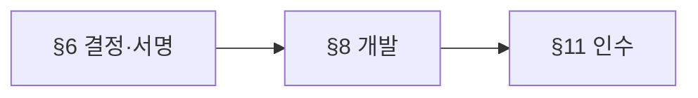
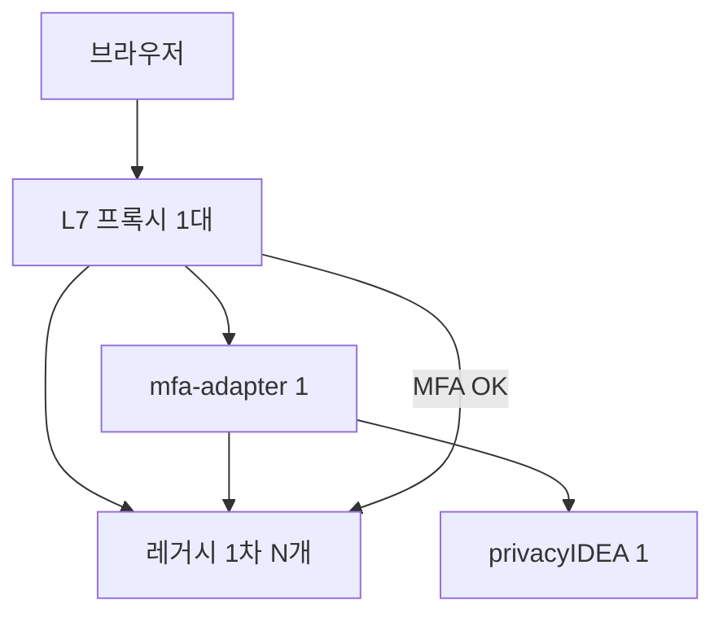
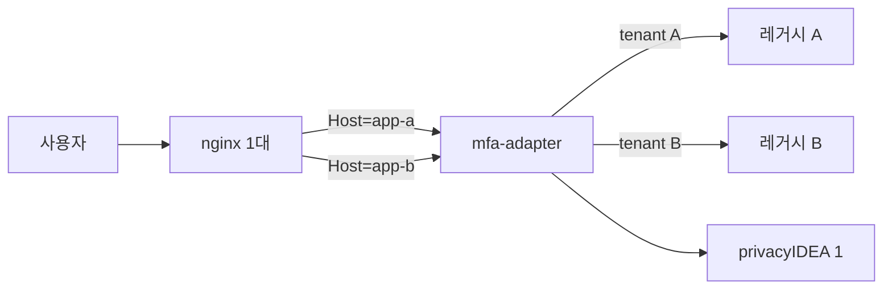

# 레거시 무수정 OTP(MFA) 연동 — 설계 보고서

| 항목 | 내용 |
|------|------|
| 코드 경로 | `poc/google-otp-2fa` |
| 이 문서 | **설계 검토 + 파일럿 전 개발·검증 계획** (운영 승인서 아님) |
| PoC 성숙도 | **TRL 4~5** — 랩 환경 샘플만 검증 (§1.2) |
| 파일럿 | §6 결정·§8 개발·§11 테스트 **증거** 후 진행 |

### 이 문서 읽는 방법

| 목적 | 읽을 곳 |
|------|---------|
| 5분 안에 전체 그림 | **§0** |
| **기존 서비스·계정·여러 앱 붙이기** | **§5** |
| 로그인·MFA가 어떻게 묶이는지 | **§2~§3** |
| PoC와 실제 운영 차이 | **§4** |
| 착수 전에 팀이 서명할 것 | **§6**, **§10.1** |
| 무엇을 고쳐야 하는지 | **§7~§8** |
| 어떻게 통과시키는지 | **§11** |

**설계 검토 판정:** 착수 **가능** / 파일럿·운영 전환은 **보류** (MFA↔1차 세션 결합, 프록시 우회 불가를 테스트로 입증할 때까지).

---

## 0. 한 페이지 요약

### 무엇을 하는가

레거시 앱 **소스는 건드리지 않고**, 앞단 **L7 프록시**와 **mfa-adapter**로 Google Authenticator(TOTP) 2차 인증을 붙인다. OTP 검증은 **privacyIDEA**(파일럿)를 쓴다.

### 로그인 흐름 (정상)

1. 사용자 → **프록시**만 접속 (레거시 포트는 밖에서 막음).
2. 프록시가 보호 URL마다 adapter에 **“1차 로그인 됐나?”** 를 묻음 (`auth_request` → probe).
3. 1차 OK이면 MFA 미완료 시 **OTP 화면**; 완료되면 레거시로 통과.
4. MFA 완료 상태는 **1차 세션 ID(probe claim)** 와 묶어 저장 (쿠키 값만 쓰지 않음).

### 배포 전제 (운영 목표)

| 전제 | 설명 |
|------|------|
| **프록시 1대** | 모든 업무 트래픽의 **유일한 L7 진입** (§6.1 N-04) |
| **MFA 플랫폼 1세트** | mfa-adapter **1개** + privacyIDEA **1개** (프로세스/클러스터는 운영 정책) |
| **여러 사이트(앱)** | 스택을 늘리지 않고 **FQDN(`Host`)별 설정**으로 구분 — `tenants.yaml` (**P0-01**), nginx 다중 `server_name` (**P0-02**) |
| 사이트마다 다를 수 있는 것 | 레거시 upstream, probe path, 1차 쿠키 이름, PI **realm** |

PoC는 **앱 1개·env 1세트**만 구현 — **다앱·계정 매핑 절차는 §5**.

### PoC vs 파일럿 (한 줄)

PoC = 랩·2개 URL만 보호·RAM에 MFA·테스트용 비밀번호.  
파일럿 = **운영 nginx**·**전체 URL 게이트**·**Redis**·**LDAP**·**§11 전체 시나리오**.

### 지금 해야 할 일 (순서)



1. **§6** — 네트워크 우회, probe 계약, 장애 시 동작 등 **미결이면 개발 중단(차단)**.
2. **§8** — PoC에 없는 보안·운영 기능 개발 (P0).
3. **§11** — 운영 nginx + PI 경로로 **E2E·부정 테스트** 후 파일럿.

---

## 1. 배경·목표

| 질문 | 답 |
|------|-----|
| 소스 무수정으로 가능한가? | **조건부** — probe·binding·직접 접근 차단·민감 URL 전수 게이트가 갖춰져야 함 |
| PoC만으로 파일럿 가능한가? | **아니오** (§4) |
| 레거시 무수정 | **최우선 목표**. probe/claim이 없으면 **최소 변경** 또는 범위 재정의 (§5) |

### 1.2 TRL 4~5 — 무엇을 했고 안 했나

| | 입증함 | 아직 안 함 |
|---|--------|------------|
| **TRL 4** | 랩 레거시 + adapter + TOTP 흐름 | 고객 레거시 HTML/세션 |
| **TRL 5** | 스크립트·harness 회귀, PI 일부 E2E | 운영 nginx, LDAP, 우회 전수, Redis 모델, 장애·롤백 |

---

## 2. 시스템 구성



| 구성요소 | 역할 |
|----------|------|
| 프록시 | 공개 URL, `auth_request`, path 게이트 |
| mfa-adapter | MFA UI, 레거시 probe, 2차 인증 상태 |
| privacyIDEA | TOTP 저장·검증 (앱별 **realm**) |
| 레거시 | 1차 로그인 (소스 변경 없음) |

**다중 사이트:** 프록시·adapter는 각 1개. 요청의 **Host**로 tenant를 고르고, 해당 레거시·realm·쿠키 설정을 쓴다 (**P0-01·02**, 미구현).

---

## 3. 인증 계약 (probe · binding)

**기본 원칙:** 에러·타임아웃을 “로그인 안 함”과 같게 취급하지 않는다. 애매하면 **막는다** (fail-closed).

### 3.1 Binding — MFA를 누구·어떤 1차 세션에 묶나

- probe JSON의 **`session_id`**(또는 `LEGACY_BINDING_CLAIM`) + HMAC. **쿠키 문자열 그대로 binding 금지**.
- MFA “완료”에는 함께 저장: **사용자 ID**, **tenant/realm**, **만료 시간**, (다사이트 시) **사이트 ID**.
- 클라이언트가 보낸 값을 믿지 않고, **probe로 확인한** 1차 세션만 사용.
- 로그아웃·1차 만료·비밀번호 변경·계정 비활성 시 MFA도 같이 무효화 (§6.4).

`레거시 login ID` = `probe의 user` = `PI user` (+ realm)

### 3.2 Probe — 레거시가 뭐라고 답해야 하나

파일럿 전에 고객·nginx와 **Probe 계약서**를 맞춘다 (P0-13). PoC 동작은 참고용.

| 레거시 응답 | adapter 처리 |
|-------------|----------------|
| JSON에 `user` + binding OK | 1차 인증됨 → MFA 단계 |
| 401/403 또는 200 빈 body | 1차 미인증 |
| HTML 로그인 페이지 | **오류** (미인증으로 착각하지 않음) |
| 타임아웃·연결 실패 | **오류** (접근 허용 안 함) |
| JSON 깨짐·user 없음 | 거부 + 로그 |

브라우저(리다이렉트)와 API(JSON)는 **응답 형식을 따로** 정한다.

---

## 4. PoC vs 파일럿/운영

| 항목 | PoC 지금 | 파일럿 목표 |
|------|----------|-------------|
| 프록시 | harness + conf 샘플 | **운영 nginx** E2E |
| 보호 URL | `/dashboard`, `/api/protected` 2개 | **전체 인벤토리** |
| 공개 포트 | hybrid (5000/5001/18080 등) | **nginx만** |
| MFA 저장 | RAM | **Redis** + TTL 정책 |
| 계정 | env / passwd | **LDAP/AD** |
| 테스트 | embedded 23 + PI 일부 | §11 + `verify_privacyidea.sh` |
| **서비스·계정** | 레거시 env + `poc-passwd` 1앱 | **tenant·realm·매핑표·P0-06** (§5) |

---

## 5. 실무: 기존 서비스·계정·다중 서비스 연동

이 절은 “프록시 1대 + MFA(adapter+PI) 1세트” 전제에서, **실제 레거시를 어떻게 붙이고**, **로그인 계정을 PI와 어떻게 맞추고**, **앱이 여러 개일 때** 무엇을 나누는지 정리한다. (코드: PoC는 **1서비스·1realm**만 동작, 다앱은 **P0-01·02·06**.)

### 5.1 기존 서비스 1개 붙일 때 (작업 순서)

| 단계 | 담당 | 할 일 |
|------|------|--------|
| 1 | 앱·인프라 | 공개 FQDN, 레거시 **내부 URL**, 1차 **세션 쿠키 이름**, 로그인·logout URL |
| 2 | 앱 | **probe** 후보 URL 정의 — 로그인한 사용자만 JSON으로 `user`(+ binding claim) 반환 (§3.2) |
| 3 | 네트워크 | 클라이언트는 **프록시만** 접근, 레거시 포트 직접 접근 차단 (N-01) |
| 4 | nginx | 민감 path 전수 `auth_request` → adapter (P0-07) |
| 5 | adapter | `LEGACY_INTERNAL_URL`, `LEGACY_PROTECTED_PATH`, `LEGACY_BINDING_CLAIM`, 쿠키 이름 env |
| 6 | PI | **realm 1개** + resolver(LDAP 또는 예외 시 passwd) — §5.3 |
| 7 | 계정 | §5.2 **매핑 규칙**으로 “레거시 로그인 ID” = “PI에서 검증할 ID” 확인 |
| 8 | 운영 | 파일럿 사용자 QR 등록(enroll) → `verify_privacyidea.sh` + §11 |

**PoC에서의 동일 패턴 (랩 레거시):**

| 항목 | PoC 값 |
|------|--------|
| 1차 로그인 | `legacy-web` `/login`, 사용자 `testuser` 또는 `test1`~`test30` |
| probe | `GET /api/protected` → `{"user":"test1","session_id":"…"}` (`session_id` = Flask `sid`) |
| 쿠키 | `legacy_session` (`LEGACY_SESSION_COOKIE_NAME`) |
| PI | realm `poc`, passwd resolver → `privacyidea/poc-passwd` (레거시 비밀번호와 **동일 계정명**) |
| 주의 | 레거시 `testN` / `testN!` 와 `poc-passwd` **불일치 시 OTP만 실패** — P0-22로 검증 |

### 5.2 계정 연동 — 세 줄로 맞추는 것

MFA는 **비밀번호를 PI에 두지 않는다**(파일럿: LDAP). PI는 **TOTP 토큰**만 관리한다. 맞춰야 하는 것은 **문자열 ID**이다.

```text
[사용자가 레거시에 입력한 로그인 ID]
        ==  probe JSON의 "user"
        ==  privacyIDEA에서 검증·enroll 하는 username (해당 realm)
```

| 계층 | 누가 검증 | PoC | 파일럿(일반) |
|------|-----------|-----|----------------|
| 1차 비밀번호 | **레거시**(또는 레거시가 붙은 AD/DB) | Flask 해시 / env | 고객 IdP·DB **변경 없음** |
| 로그인 여부 판별 | adapter가 **probe**로 확인 | `/api/protected` | 고객이 지정한 URL |
| 2차 OTP | **privacyIDEA** | realm `poc` | 서비스별 realm 권장 |
| MFA 완료 상태 | adapter(+Redis) | RAM | `user` + **tenant** + binding (§3.1) |

**레거시 ID ≠ AD sAMAccountName** 이면 **매핑 표**가 필요하다 (P0-06). adapter는 probe가 돌려준 `user`를 매핑한 뒤 PI를 호출하도록 확장한다.

| 패턴 | 예 | 처리 |
|------|-----|------|
| 동일 ID | 레거시 `hong.gildong` = AD `hong.gildong` | 매핑 없음 |
| 도메인 접두 | `CORP\hong` | 정규화 규칙 1개로 문서화 (소문자, `@` 제거 등) |
| 레거시만 다른 키 | 레거시 `emp001`, AD `hong.gildong` | **매핑 테이블** `emp001 → hong.gildong` |
| 이메일 로그인 | `user@company.com` | PI·LDAP에 동일 필드 또는 매핑 |

### 5.3 privacyIDEA와 “기존 계정 디렉터리”

| 방식 | 언제 | 연동 내용 |
|------|------|-----------|
| **LDAP/AD resolver** (파일럿 기본) | 전사/앱 계정이 AD에 있음 | PI는 AD **읽기**; 사용자 **비밀번호는 레거시·AD 검증 그대로**. PI에 OTP **토큰만** 생성 |
| **passwd 파일** (PoC) | 랩·소규모 | `poc-passwd` 사용자명 = 레거시 로그인명; `bootstrap_privacyidea_poc.sh`로 realm `poc` 연결 |
| **PI에 사용자 수동 생성** | 비권장 | LDAP과 이중 관리 — 퇴사·잠금 불일치 |

**Enroll(최초 QR):** 1차 로그인 성공 → adapter가 PI에 “이 username 토큰 있음?” → 없으면 setup UI → QR 스캔 → 이후 validate.

**퇴사·잠금:** AD 비활성화만으로는 **이미 발급된 TOTP**가 남을 수 있음 → PI에서 토큰 삭제 SLA (A-06, A-18).

### 5.4 다중 서비스 (앱 여러 개, 프록시·MFA 각 1대)

서비스를 구분하는 **키**는 공개 **FQDN(`Host`)** 이다. 스택을 복제하지 않는다.



**서비스(tenant)마다 다를 수 있는 것:**

| 설정 | 서비스 A | 서비스 B |
|------|----------|----------|
| 공개 URL | `https://hr.company.com` | `https://erp.company.com` |
| 레거시 upstream | `http://10.0.1.10:8080` | `http://10.0.2.20:8080` |
| probe path | `/api/session` | `/api/protected` |
| 1차 쿠키 이름 | `JSESSIONID` (예) | `legacy_session` |
| binding claim | `session_id` | `sid` |
| **PI realm** | `hr` | `erp` |
| 민감 path 목록 | HR 인벤토리 | ERP 인벤토리 |

**같은 사용자가 앱 A·B 모두 쓸 때 (정책 선택):**

| 정책 | 1차 로그인 | MFA | 비고 |
|------|------------|-----|------|
| **앱별 MFA** (기본 권장) | 앱마다 별도 세션 | realm·MFA 상태 **앱별 분리** | HR에서 MFA 해도 ERP는 별도 OTP |
| **한 번 MFA로 여러 앱** | 앱마다 세션 | 공유 정책·위험 높음 | 명시적 보안 서명 필요 |

adapter Redis 키에 반드시 **`tenant_id`(또는 Host)** 를 넣어 **A의 MFA로 B를 열 수 없게** 한다 (§11 A-07 확장).

**목표 설정 예 (`tenants.yaml` — P0-01, 아직 코드 없음):**

```yaml
tenants:
  - id: hr
    hosts: ["hr.company.com"]
    legacy_internal_url: "http://10.0.1.10:8080"
    legacy_protected_path: "/api/session"
    legacy_session_cookie: "HRSESSION"
    legacy_binding_claim: "session_id"
    privacyidea_realm: "hr"
    # optional: mapping_table: "/etc/mfa/map-hr.csv"

  - id: erp
    hosts: ["erp.company.com"]
    legacy_internal_url: "http://10.0.2.20:8080"
    legacy_protected_path: "/api/protected"
    legacy_session_cookie: "legacy_session"
    legacy_binding_claim: "sid"
    privacyidea_realm: "erp"
```

nginx는 **P0-02**: `server_name`별 upstream + 동일 `auth_request` URI (adapter가 Host로 tenant 선택).

### 5.5 다중 서비스 × 계정 (서비스마다 ID가 다를 때)

| 상황 | 예 | 해결 |
|------|-----|------|
| 같은 사람, 앱마다 로그인 ID 다름 | HR `emp001`, ERP `E-9001` | tenant별 **매핑 파일** → PI는 realm마다 **정규화된 PI user** 하나 |
| 같은 AD 계정, 앱 2개 | `hong.gildong` 동일 | realm `hr` / `erp` 각각 **OTP enroll 2번** (앱별 정책) 또는 전사 realm 1개(정책 결정) |
| 공용·배치 계정 | `batch_report` | OTP **제외** 목록 (A-07), 프록시에서 MFA 스킵은 위험 — **별도 네트워크·계정** 권장 |
| 외주·협력사 | AD 없음 | 해당 tenant만 passwd/SQL resolver 또는 제외 |

**매핑 표 예 (P0-06 산출물):**

| tenant | legacy_login (probe user) | pi_username | realm | 비고 |
|--------|---------------------------|-------------|-------|------|
| hr | emp001 | hong.gildong | hr | HR 구번호 |
| erp | E-9001 | hong.gildong | erp | ERP 사번 |
| hr | test1 | test1 | hr | PoC 1:1 |

검증: 샘플 N명 **100%** — 레거시 로그인 → probe user → PI validate/enroll 성공 (P0-06).

### 5.6 연동 시 자주 깨지는 것

| 증상 | 원인 | 확인 |
|------|------|------|
| 1차 OK, OTP만 실패 | PI에 사용자 없음 / realm 다름 / ID 불일치 | `user` vs PI token owner |
| 새로고침마다 OTP | binding이 쿠키만 봄 | `LEGACY_BINDING_CLAIM`·probe `session_id` |
| 앱 B가 앱 A MFA로 열림 | tenant 미분리 | Host·Redis 키·realm |
| AD 비번 바꿨는데 OTP만 됨 | 정상(1차는 레거시) | PW 변경 후 MFA 재요구 정책 (S-06) |
| `poc-passwd`만 수정 | 레거시 env와 불일치 | P0-22 |

### 5.7 범위 (In / Out)

| 포함 | 제외 |
|------|------|
| 프록시·adapter·PI, TOTP, §5 연동 절차 | 레거시 대규모 소스 수정, 전사 SSO |
| 브라우저·세션 쿠키, **다 FQDN 다 tenant** | 네이티브 앱, Bearer-only API (별도 설계) |

---

## 6. Phase 0 — 착수 전에 결정·서명

**차단** = 답이 없으면 그 항목 관련 개발·파일럿을 **하지 않음**.

### 6.0 차단 요약 (먼저 여기만 보면 됨)

- **N-01, N-04** — 레거시·DB를 프록시 밖에서 직접 못 붙게 (IPv4/IPv6·컨테이너 포트·구 FQDN 포함).
- **N-02** — 보호할 **URL 전체 목록** (API·다운로드·WebSocket·메서드 포함).
- **L-01~L-03** — probe URL·JSON·binding 필드 (**§3.2**).
- **S-01, S-01b** — PI/adapter 죽었을 때 **신규 접근** vs **이미 MFA 한 세션** 동작.
- **S-07 + L-05** — 로그아웃 시 1차·MFA 같이 지우기.

### 6.1 네트워크·우회

| ID | 확인할 것 | 안 되면 |
|----|-----------|---------|
| N-01 | 클라이언트가 레거시·DB·관리 포트 **직접** 접근 가능? | **차단** |
| N-02 | 모든 FQDN·path·API 목록 있음? | 게이트 누락 |
| N-03 | CDN이 세션 없이 API 호출? | 설계 변경 |
| N-04 | 업무 트래픽 **프록시만** 경유? | **차단** |
| N-05 | 시연 시 5000/5001이 `0.0.0.0`? | 우회 → 시연 중단 |

### 6.2 레거시·probe

| ID | 확인할 것 |
|----|-----------|
| L-01 | probe URL·HTTP 메서드 |
| L-02 | 응답이 JSON인지 (HTML이면 Fail) |
| L-03 | binding claim 이름·세션 동안 불변 |
| L-04 | 로그인 후 리다이렉트 UX |
| L-05 | logout URL·메서드 (PoC: adapter가 `GET /logout`) |
| L-06 | 1차 TTL vs MFA TTL |
| L-07 | 오픈 리다이렉트(`next` 등) |

### 6.3 계정·privacyIDEA·다중 서비스

| ID | 결정할 것 | §5 참고 |
|----|-----------|---------|
| A-01 | User Store **원본**(AD/HR/DB) — 1차 비번 검증 주체 | §5.2, §5.3 |
| A-02 | login ID 규칙·**서비스별 매핑**(§5.5 표) | P0-06 |
| A-03 | PI Add User 필요 여부 (LDAP면 보통 **불필요**) | §5.3 |
| A-04 | **realm**: 앱 1개당 1 realm vs 전사 1 realm | §5.4 |
| A-05 | Enroll(self QR / admin) | §5.1 8단계 |
| A-06 | 퇴사·분실 시 토큰 삭제 SLA | §5.3 |
| A-07 | 공용·batch 계정 OTP 제외 | §5.5 |
| A-08 | VPN/메일 MFA 중복 | 정책 |
| **M-01** | 연동 **서비스 목록**(FQDN·내부 URL·쿠키·probe) | §5.4 표 |
| **M-02** | 서비스별 **앱별 MFA vs 공유 MFA** | §5.4 정책 표 |
| **M-03** | tenant당 매핑 파일 필요 여부 | §5.5 |

**파일럿 PI 최소:** MariaDB/MySQL, LDAP resolver, admin 기본값 제거, UI는 관리망만, 이미지 digest, lockout, 백업 1회.

### 6.4 세션·장애

| ID | 결정할 것 |
|----|-----------|
| S-01 | 장애 시 **새 MFA·보호 API** → 막기 (fail-closed) |
| S-01b | 장애 시 **이미 MFA 완료 세션** → 유지 vs 전부 재인증 |
| S-02~S-03 | adapter/Redis 장애 |
| S-04~S-06 | 만료·동시 로그인·PW 변경·계정 비활성 |
| S-07 | 로그아웃 연동 |
| S-08 | Redis 보안(TLS·ACL) |

### 6.5 클라이언트

PC 브라우저 기본. SPA·모바일·Bearer API·WebSocket은 **별도 범위** 또는 path 인벤토리에 포함 여부 결정.

### 6.6 프록시 제품

파일럿: **nginx** (P0-14). F5/IIS/ALB는 P1.

### 6.7 파일럿 전에 문서·코드가 맞아야 하는 것

| 주제 | 맞출 곳 |
|------|---------|
| probe 응답 정의 | §3.2, Probe 계약서 |
| 장애 시 기존 MFA 세션 | S-01b |
| auth-check 외부 호출 | P0-18, 프록시만 접근 |
| path 우회(인코딩 등) | P0-07, A-15 |

---

## 7. PoC 코드/배포의 구멍

운영에 그대로 두면 위험한 것만 정리. 상세 ID는 **§8** P0와 연결.

| 영역 | 대표 문제 | P0 |
|------|-----------|-----|
| adapter | demo 시크릿, RAM MFA, auth-check 노출, PI 오류 시 “미등록”으로 착각 | P0-03, 10, 16, 17, 18, 23 |
| nginx | 2 path만 보호, harness ≠ 운영 | P0-07, 14 |
| 배포 | lab/lan/prod 혼선, 계정 수동 동기 | P0-04, 20, 22 |
| 테스트 | embedded 통과 ≠ PI 안전 | §11, `verify_privacyidea.sh` |

상세 ID는 **부록 A**.

---

## 8. 개발 백로그

### 8.0 우선순위 말하기

| 등급 | 의미 |
|------|------|
| **P0-Blocker** | 없으면 파일럿 불가 (§10.1) |
| **P0-Required** | 파일럿 필수 (병렬 가능) |
| **P1** | 파일럿 후 운영 확장 전 |
| **P2** | 선택·규모 |

**보안 순서:** 우회 방지 → MFA binding → path·내부 API → 세션·장애 → 운영 (§12).

**진행 단계:**

1. §6 전부 확정  
2. P0-07~10, 13, 15~19, 23~24 (우회·게이트·시크릿)  
3. P0-03, 05~06, 11, 14, 20~22 (Redis·LDAP·운영 nginx)  
4. P0-01~02, 04, 12, 17, 25 + §11 (다앱·인수·롤백)

### 8.1 파일럿 블로커 (핵심 P0)

| ID | 한 줄 설명 |
|----|------------|
| P0-07 | 민감 URL 목록 → nginx 생성 |
| P0-08 | 레거시 직접 접근 감사 |
| P0-09 | HTTPS·Secure 쿠키 |
| P0-10 | demo 시크릿이면 기동 실패 |
| P0-13 | probe 계약 자동 검증 |
| P0-14 | **운영 nginx** E2E |
| P0-16 | demo UI/API 제거 |
| P0-17 | PI 장애 fail-closed (+ S-01b) |
| P0-18 | auth-check 프록시 전용 |
| P0-19 | 레거시 포트 localhost만 |

### 8.2 나머지 P0 (요약)

| ID | 내용 |
|----|------|
| P0-01 | `tenants.yaml` — Host별 legacy·probe·cookie·realm |
| P0-02 | 다중 FQDN nginx |
| P0-03 | Redis + §6.4 상태 모델 |
| P0-04 | lab / lan / prod 프로파일 |
| P0-05~06 | LDAP·계정 매핑 검증 CLI |
| P0-11 | 구조화 로그 |
| P0-12 | §11 인수 패키지·서명 |
| P0-15 | legacy URL allowlist (SSRF) |
| P0-20~22 | LAN/compose 정합·SBOM·계정 동기 |
| P0-23~24 | 금지 env·쿠키 체크리스트 |
| P0-25 | 롤백·kill-switch 리허설 |

### 8.3 P1 · 8.4 P2

**P1:** F5/IIS 스니펫, WebSocket path, 모니터링, mTLS, 토큰 lifecycle 등.  
**P2:** PI HA, break-glass, OIDC step-up 등.

---

## 9. 아직 PoC에서 안 해본 것

다중 탭, PW 변경 후 MFA, POST API 게이트, 동시 로그인 N개, SPA 403 처리 등 — 파일럿 테스트(§11)에 넣거나 범위 밖으로 명시.

---

## 10. 파일럿 착수 체크리스트

### 10.1 서명 전

- [ ] §6.0 차단 항목 (N-01·N-04, L-01~03, S-01·S-01b·S-07)
- [ ] **§5** 서비스 목록·계정 매핑 표·realm (M-01~03, P0-06)
- [ ] §3.2 probe 계약 (P0-13)
- [ ] PI 운영 MUST (§6.3)
- [ ] §8.1 블로커 P0 완료
- [ ] §11 시나리오 Pass

### 10.2 요구사항 → 개발 → 테스트

| 요구사항 | P0 | 테스트 |
|----------|-----|--------|
| 직접 접근 차단 | 08, 19 | A-01 |
| MFA↔1차 결합 | 03, 13 | A-06, 07, 13 |
| URL 전수 게이트 | 07 | A-08, 15 |
| TLS·쿠키 | 09, 24 | A-11 |
| 장애 | 17 | A-05, 16 |
| 운영 nginx | 14 | A-09 |
| PI OTP 정책 | 05, §7 | A-17, verify_pi |
| **다 tenant 계정** | 01, 06 | 매핑 표 N명 + A-07(타 tenant MFA) |
| **다 FQDN** | 02 | Host별 E2E |

---

## 11. 검증·인수

### 11.1 자동 스크립트

| 명령 | 하는 일 | 한계 |
|------|---------|------|
| `./scripts/run_tests.sh` | embedded 23 | PI·운영 nginx 아님 |
| `./scripts/verify_privacyidea.sh` | PI E2E | admin env 필요 |
| `./scripts/verify_all.sh` | 위 통합 | LAN 회귀 없음 |

### 11.2 인수 시나리오 (P0-12)

**필수 이해:** A-03(새로고침 20회)만으로는 부족. **A-07, 12~14**로 타 사용자·만료·binding 교차를 본다. embedded 테스트는 **PI에서도 반복** (§7).

**기본 흐름**

| # | 시나리오 |
|---|----------|
| A-01 | 레거시 포트 직접 접근 → 실패 |
| A-02 | 1차만 → MFA 요구 |
| A-03 | MFA 후 refresh 20회 |
| A-04 | 로그아웃 후 보호 URL |
| A-09 | **운영 nginx**에서 A-02~04 반복 |

**보안·부정**

| # | 시나리오 |
|---|----------|
| A-06~07 | 위조 헤더/쿠키, 타 사용자 MFA |
| A-12~14 | MFA 만료, 세션 교차, 세션 ID 재발급 |
| A-15 | path 인코딩·`//` 우회 |
| A-17 | OTP 재사용 (PI·embedded 각각) |
| A-19~21 | 세션 고정, 잘못된 설정, CSRF(범위 시) |

**장애·운영**

| # | 시나리오 |
|---|----------|
| A-05 | PI stop → fail-closed (S-01b) |
| A-16 | PI/Redis/adapter/레거시 장애 주입 |
| A-10 | demo·테스트 API 없음 |
| A-11 | Secure/HttpOnly 쿠키 |
| A-18 | 계정 비활성·토큰 삭제 |
| A-20 | demo secret·잘못된 Host |
| A-22 | **tenant A**에서 MFA 후 **tenant B** URL | B는 MFA 요구 (§5.4) |
| A-23 | 서비스별 매핑 사용자 (§5.5 표 샘플) | probe user → PI validate OK |

인수 시 **환경·이미지 digest·설정 버전·시각·로그·승인자**를 남긴다.

### 11.3 LAN 시연 (랩 전용 · 운영 아님)

```bash
cd poc/google-otp-2fa
ss -tlnp | grep -E ':5000|:5001|:18080|:18081'
LAN_PUBLISH=1 PROXY_BIND_HOST=0.0.0.0 ./scripts/run_privacyidea_demo.sh
```

- `0.0.0.0` = 모든 NIC 수신 → **방화벽·허용망** 확인.
- `ss`만으로는 방화벽·Docker publish는 안 보임 (N-01).
- 시연 끝나면 포트 복구; **prod는 demo/LAN 옵션 거부** (P0-04·10).

### 11.4 주요 환경 변수

| 변수 | 용도 |
|------|------|
| `LEGACY_INTERNAL_URL` / `LEGACY_PROTECTED_PATH` | probe |
| `LEGACY_BINDING_CLAIM` / `LEGACY_SESSION_COOKIE_NAME` | binding |
| `MFA_BACKEND` | `privacyidea` (파일럿) |
| `PRIVACYIDEA_REALM` | 사이트(앱)별 realm (다앱 시 tenant 설정) |

---

## 12. 보안 우선순위 (짧게)

| 순위 | 리스크 | §6 | P0 |
|------|--------|-----|-----|
| 1 | 프록시 우회 | N-01, N-04 | 08, 19 |
| 2 | MFA binding | L-03, §3 | 03, 13 |
| 3 | path·auth-check | N-02, §6.7 | 07, 18 |
| 4 | HTTP | — | 09 |
| 5 | 장애·세션 | S-01~08 | 17, 03 |
| 6 | PI·시크릿 | §6.3 | 05, 10 |

---

## 부록 A. 구현 갭 ID (티켓 매핑용)

### A.1 mfa-adapter (I-*)

| ID | 현재 | 목표 | P0 |
|----|------|------|-----|
| I-01 | demo 시크릿 기본값 | 기동 거부 | 10 |
| I-02 | demo OTP UI | 운영 제거 | 16 |
| I-03 | 테스트 API | 운영 금지 | 23 |
| I-04 | RAM, TTL 없음 | Redis + 정책 | 03 |
| I-05 | PI 오류 → 미등록 | fail-closed | 17 |
| I-06 | 쿠키 fallback | claim 필수 | 13 |
| I-07 | probe 3s 타임아웃 | 모니터링 | 11 |
| I-08 | auth-check 공개 | 프록시 전용 | 18 |
| I-09 | legacy URL 고정 | allowlist | 15 |
| I-10 | embedded만 OTP 테스트 | PI 동등 테스트 | §11 |

### A.2 nginx (P-*)

| ID | 현재 | 목표 | P0 |
|----|------|------|-----|
| P-01 | 2 path | 인벤토리 → nginx | 07 |
| P-02 | location 미전수 | 전 path | 07 |
| P-03 | harness만 | 운영 nginx E2E | 14 |
| P-04 | bypass 헤더 strip | 운영에도 유지 | — |

### A.3 배포 (D-*)

| ID | 현재 | 목표 | P0 |
|----|------|------|-----|
| D-01 | LAN env 혼선 | 프로파일 분리 | 04, 20 |
| D-02 | 계정 수동 동기 | CLI 검증 | 22 |
| D-03 | verify 후 bind | LAN 체크리스트 | 04 |
| D-04 | compose vs 스크립트 | 정합 | 20 |

### A.4 embedded vs PI

| | embedded | PI |
|---|----------|-----|
| 회귀 | 23건 harness | ~10 E2E |
| OTP reuse | 있음 | **별도 필수** |
| **원칙** | embedded Pass ≠ PI 안전 | `verify_privacyidea.sh` 필수 |
