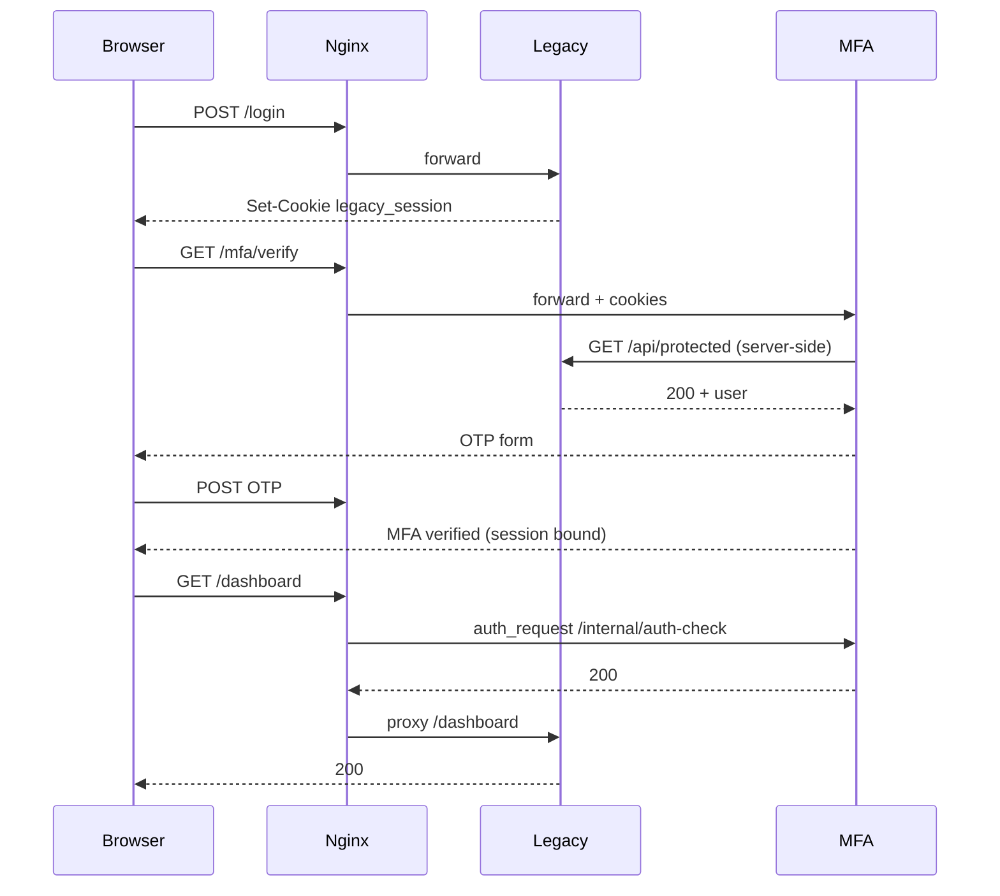

# Google Authenticator TOTP 2FA PoC (legacy + MFA + reverse proxy)

Proof of concept: a **legacy** Flask app performs ID/PW login only; **`mfa-adapter`** handles TOTP via **embedded PoC logic** or **[privacyIDEA](https://github.com/privacyidea/privacyidea)** (open source); **Nginx** gates `/dashboard` and `/api/protected` until MFA is complete.

## Directory layout

```
poc/google-otp-2fa/
├── README.md
├── HANDOVER.md          # 운영 환경 적용·인수인계 가이드
├── SECURITY.md
├── docker-compose.yml
├── .env.example
├── nginx/nginx.conf
├── legacy-web/          # ID/PW only (no MFA)
├── mfa-adapter/         # MFA gateway (embedded or privacyIDEA backend)
├── mfa-service/         # deprecated — see DEPRECATED.md
├── privacyidea/         # privacyIDEA overlay docs
├── tests/               # pytest (login, MFA, bypass, security)
└── scripts/run_tests.sh
```

## Architecture



## Test account (PoC)

| Field | Default |
|--------|---------|
| Username | Password |
|----------|----------|
| `testuser` | `TestPassword123!` |
| `test1` … `test5` | `test1!` … `test5!` |

Full list: [TEST_ACCOUNTS.md](TEST_ACCOUNTS.md). Override via `LEGACY_TEST_ACCOUNTS` or `.env` (see `.env.example`).

## Interactive browser test (no install on your PC)

The stack runs **on the Cloud Agent VM**, not on your laptop.

1. In this agent chat, ask the agent to run (or run in the agent terminal):

   ```bash
   cd poc/google-otp-2fa && ./scripts/run_demo_stack.sh
   ```

2. Open the app in a browser **attached to the agent** (not your local machine unless port forwarding is enabled):
   - **Cursor → this Cloud Agent → Ports / Preview** (if shown): open port **18080**
   - Or use the agent’s **browser / desktop** tools when available

3. URL: **http://127.0.0.1:18080/login** (on the agent VM)

4. Account: `testuser` / `TestPassword123!`

5. On MFA pages (with `MFA_TEST_MODE=true` in the demo script), click **“PoC: verify with test OTP”** or **“PoC: enroll with test OTP”** so you do not need Google Authenticator or manual typing.

6. Then open `/dashboard` and `/api/protected`.

Stop services: `fuser -k 18080/tcp 5000/tcp 5001/tcp` (on the agent VM).

## Run in Cursor Agent (no local install on your PC)

### Automated tests (recommended)

```bash
cd poc/google-otp-2fa
chmod +x scripts/run_tests.sh
./scripts/run_tests.sh
```

This creates a venv, installs dependencies, starts legacy + MFA + a **Python proxy harness** (same rules as `nginx/nginx.conf`), and runs pytest.

### Docker Compose (when Docker daemon is available)

**Embedded TOTP (default, same as pytest):**

```bash
cd poc/google-otp-2fa
docker compose up --build
# http://localhost:8080/login
```

**privacyIDEA (open-source MFA server):**

```bash
./scripts/run_privacyidea_stack.sh
# First time: create admin — see privacyidea/README.md
```

Only `nginx-proxy` publishes port `8080`. Legacy, adapter, and privacyIDEA stay on the internal network.

**Cursor Agent diagnosis (this run):** Docker CLI installed after `apt`, but **Docker daemon not available** (`/var/run/docker.sock` missing). Compose integration was **not** executed here.

## Google Authenticator registration

1. Log in at `/login`
2. Open `/mfa/setup` (or follow redirect to `/mfa/verify` then setup)
3. Scan the QR code with Google Authenticator (or enter the `otpauth://` secret manually)
4. Enter a 6-digit code to confirm
5. Access `/dashboard`

## Test results (Cursor Agent, 2026-10-13)

Command:

```bash
./scripts/run_tests.sh
```

Outcome: **18 passed**, 0 failed (≈2.1s).

| Category | Tests |
|----------|-------|
| Login | 3 |
| MFA | 3 |
| Bypass | 6 |
| Security | 4 |
| Docker compose static | 1 |
| Nginx config syntax | 1 |

Integration path: Python **proxy harness** (`tests/proxy_harness.py`) emulating nginx `auth_request`. **Docker Compose end-to-end was not run** (no Docker daemon in this environment).

## Limitations

- MFA state is in-memory (not production-safe).
- Legacy ID/PW code is unchanged; MFA trusts legacy session via server-side `/api/protected` call — see `SECURITY.md`.
- Direct access to legacy ports bypasses MFA unless network-isolated.
- HTTPS not used locally; set `*_COOKIE_SECURE=true` behind TLS in production.

## Legacy code modification

**ID/PW authentication logic in `legacy-web/app.py` was not modified for MFA.** No OTP, no MFA hooks in login. The only coupling is MFA’s **out-of-band** validation using the existing protected API with the user’s session cookie.
