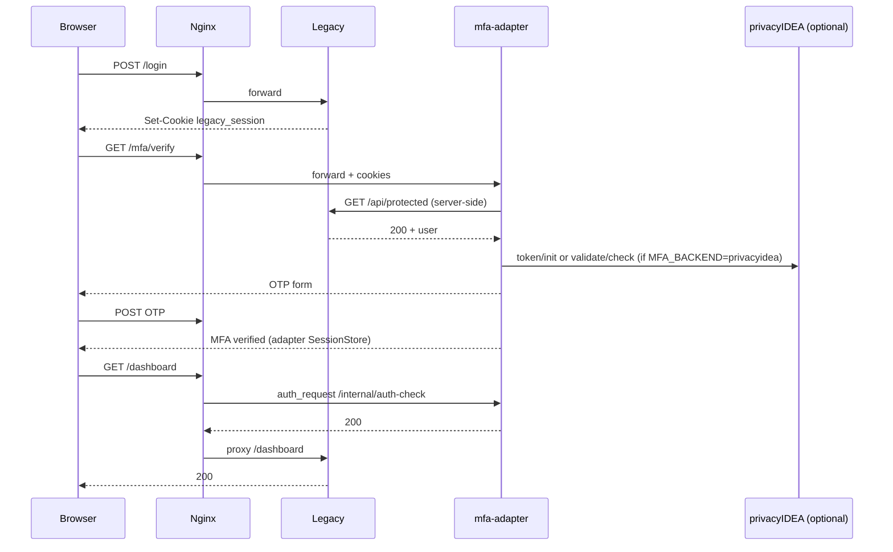

# Google Authenticator TOTP 2FA PoC (legacy + MFA + reverse proxy)

Proof of concept: a **legacy** Flask app performs ID/PW login only; **`mfa-adapter`** handles TOTP via **embedded PoC logic** or **[privacyIDEA](https://github.com/privacyidea/privacyidea)** (open source); **Nginx** gates `/dashboard` and `/api/protected` until MFA is complete.

**Related docs:** [HANDOVER.md](HANDOVER.md) (운영 인수인계) · [SECURITY.md](SECURITY.md) · [TEST_ACCOUNTS.md](TEST_ACCOUNTS.md) · [privacyidea/README.md](privacyidea/README.md)

## Directory layout

```
poc/google-otp-2fa/
├── README.md
├── HANDOVER.md          # 운영 환경 적용·인수인계
├── SECURITY.md          # 보안 설계·검증 범위
├── TEST_ACCOUNTS.md     # PoC 테스트 계정
├── docker-compose.yml
├── docker-compose.privacyidea.yml
├── .env.example
├── nginx/nginx.conf
├── legacy-web/          # ID/PW only (no MFA)
├── mfa-adapter/         # MFA gateway (embedded or privacyIDEA)
├── mfa-service/         # deprecated — see DEPRECATED.md
├── privacyidea/         # privacyIDEA overlay docs
├── tests/               # pytest
└── scripts/
    ├── run_tests.sh              # embedded regression (default)
    ├── run_demo_stack.sh         # browser demo on host (embedded, MFA_TEST_MODE)
    ├── run_privacyidea_stack.sh  # full Compose + privacyIDEA
    ├── run_privacyidea_cloud_test.sh  # hybrid: PI in Docker, rest on host
    └── test_privacyidea_e2e.sh   # optional full-Docker E2E
```

## Architecture



| `MFA_BACKEND` | TOTP secrets / enrollment | `MFA_VERIFIED` (2차 완료) |
|---------------|---------------------------|---------------------------|
| `embedded` | In adapter memory | Adapter `SessionStore` + `mfa_session` cookie |
| `privacyidea` | privacyIDEA DB/API | Same adapter session store (not in PI) |

## Test accounts (PoC)

| Username | Password |
|----------|----------|
| `testuser` | `TestPassword123!` |
| `test1` … `test5` | `test1!` … `test5!` |

Details: [TEST_ACCOUNTS.md](TEST_ACCOUNTS.md). Override with `LEGACY_TEST_ACCOUNTS` (see `.env.example`).

## Interactive browser test (no install on your PC)

The stack runs **on the Cloud Agent VM**, not on your laptop.

### Embedded demo (PoC OTP buttons)

1. In this agent chat, ask the agent to run:

   ```bash
   cd poc/google-otp-2fa && ./scripts/run_demo_stack.sh
   ```

2. Open the app from the agent environment (Ports/Preview for **18080**, or agent browser tools).

3. URL: **http://127.0.0.1:18080/login**

4. Account: e.g. `testuser` / `TestPassword123!`

5. On MFA pages (`MFA_TEST_MODE=true`), use **“PoC: verify with test OTP”** / **“PoC: enroll with test OTP”** — no Google Authenticator required.

6. Visit `/dashboard` and `/api/protected`.

Stop: `fuser -k 18080/tcp 5000/tcp 5001/tcp` (on the agent VM).

### privacyIDEA mode (real TOTP flow)

- Use `./scripts/run_privacyidea_stack.sh` when Docker works end-to-end, or `./scripts/run_privacyidea_cloud_test.sh` for **hybrid** (PI on `127.0.0.1:18081`).
- **`MFA_TEST_MODE=false`** in the privacyIDEA overlay — no PoC OTP hint buttons; scan QR with Google Authenticator (or enter secret from setup page).

See [privacyidea/README.md](privacyidea/README.md).

## Run in Cursor Agent (no local install on your PC)

### Automated tests (recommended)

```bash
cd poc/google-otp-2fa
chmod +x scripts/run_tests.sh
./scripts/run_tests.sh
```

Requires `python3-venv` on the VM (`apt install python3.12-venv` if `ensurepip` fails).

This creates a venv, installs dependencies, starts legacy + **mfa-adapter** + a **Python proxy harness** (same rules as `nginx/nginx.conf`), and runs pytest with **`MFA_BACKEND=embedded`**.

**Optional privacyIDEA integration** (privacyIDEA container listening, e.g. hybrid script):

```bash
export PRIVACYIDEA_E2E_URL=http://127.0.0.1:18081
pytest tests/test_privacyidea_integration.py -v
```

### Docker Compose

**Embedded TOTP (default, same as pytest):**

```bash
cd poc/google-otp-2fa
docker compose up --build
# http://localhost:8080/login
```

**privacyIDEA overlay:**

```bash
./scripts/run_privacyidea_stack.sh
# First boot: admin from PRIVACYIDEA_ADMIN_* — see privacyidea/README.md
```

Only **`nginx-proxy`** publishes host port **8080**. Legacy, mfa-adapter, and privacyIDEA stay on the internal network (overlay may bind PI to `127.0.0.1:18081` for lab tests).

**Cloud Agent note:** Docker may need `sudo dockerd &` and `sudo docker compose`. Some VMs have **broken container-to-container networking** — use `scripts/run_privacyidea_cloud_test.sh` for privacyIDEA validation instead of relying on full Compose everywhere.

## Google Authenticator registration (manual)

1. Log in at `/login`
2. Open `/mfa/setup` (or follow redirect from `/mfa/verify`)
3. Scan the QR code (or enter the `otpauth://` secret)
4. Enter a 6-digit code to confirm
5. Access `/dashboard`

With **`embedded`** + `MFA_TEST_MODE=true`, the demo script can skip manual OTP. With **`privacyidea`**, use a real authenticator app.

## Test results

| Suite | Command | Typical outcome |
|-------|---------|-----------------|
| Main regression | `./scripts/run_tests.sh` | **21 passed** (`embedded`, proxy harness) |
| privacyIDEA API | `PRIVACYIDEA_E2E_URL=http://127.0.0.1:18081 pytest tests/test_privacyidea_integration.py` | **3 passed** when PI is up |

| Category (main suite) | Tests |
|------------------------|-------|
| Login | 3 |
| MFA | 3 |
| Bypass | 6 |
| Security | 4 |
| Multi-account | 3 |
| Docker compose static | 1 |
| Nginx config syntax | 1 |

Integration path: Python **proxy harness** (`tests/proxy_harness.py`) emulating nginx `auth_request`. Live **nginx + all containers** is environment-dependent.

## Limitations

- **`MFA_VERIFIED`** and **`embedded`** TOTP state are in-memory in the adapter — not production-safe.
- With **`privacyidea`**, TOTP secrets live in privacyIDEA; adapter still keeps short-lived MFA completion in memory.
- Legacy ID/PW code is unchanged; MFA trusts legacy session via server-side `/api/protected` — see [SECURITY.md](SECURITY.md).
- Direct access to legacy ports bypasses MFA unless network-isolated.
- PoC privacyIDEA image **`gpappsoft/privacyidea-docker`** is third-party; production should build from upstream privacyIDEA.
- HTTPS not used locally; set `*_COOKIE_SECURE=true` behind TLS in production.

## Legacy code modification

**ID/PW authentication logic in `legacy-web/app.py` was not modified for MFA.** No OTP, no MFA hooks in login. The adapter validates the existing protected API with the user’s session cookie.
